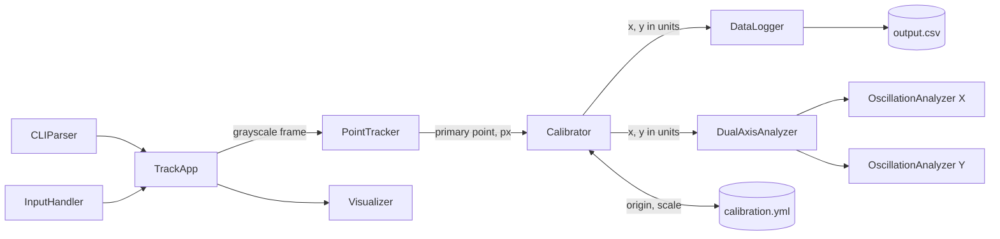

# TrackXY — architecture

Reference documentation for the code. For method and rationale, read the
[technical report](technical-report.md) first.

## Component map



`TrackApp` owns the frame loop and nothing else. Every other component is constructible and testable
without a camera, a window, or a display.

## Frame lifecycle

Each iteration of `TrackApp::run`:

1. Pull a frame from the capture (`InputHandler::open` returns a `VideoCapture`, camera index or path).
2. Copy the frame to the display buffer; convert to grayscale.
3. If a primary point exists, `PointTracker::update` with the new grayscale frame.
4. If tracking survived: take `std::chrono::steady_clock` elapsed time, transform the primary point
   through `Calibrator`, append a CSV row, feed the calibrated pair to `DualAxisAnalyzer`.
5. Read frequency/amplitude/phase and draw the overlay.
6. Poll the keyboard with a 10 ms budget.

Logging happens only when a point exists, so a gap in the CSV means "no valid measurement", never
"the process was slow".

## Contracts

| Component | Guarantee | Consequence if violated |
|---|---|---|
| `PointTracker` | `getPoints()[0]`, when present, is the feature that was initialised | Measurements stay smooth while silently describing a different object |
| `PointTracker` | A lost primary point clears all points | Tracking stops visibly instead of re-indexing to a chaperone |
| `Calibrator` | `transform` maps px → units by `(p − origin) / pixelsPerUnit` | A scale error survives every downstream calculation |
| `OscillationAnalyzer` | No frequency before 10 samples and 4 mean crossings | A two-crossing estimate reports the sample rate, not the oscillation |
| `DataLogger` | One row per logged sample; header written at construction | Downstream parsing breaks silently |
| `DualAxisAnalyzer` | Phase in `[−180°, +180°]`, Y relative to X | A wrapped or unnormalised phase reads as a different physical mode |
| `tools/measurement_receipt.py` | `verify` recomputes every recorded digest and chain | A tampered result file passes as genuine |

The first two carry the most weight. Everything else can be re-derived from the CSV; a switched
target cannot be recovered after the fact.

## Tracking

- **Initialise.** `goodFeaturesToTrack(quality=0.01, minDistance=10, blockSize=3, useHarris=false,
  k=0.04)` → `cornerSubPix(10×10, 20 iterations, 0.03 px)`. The ROI variant builds a `CV_8UC1` mask
  and sets the selected rectangle to 255.
- **Update.** `calcOpticalFlowPyrLK(prev, next, points, nextPoints, status, err, winSize=31×31,
  maxLevel=3, termcrit, flags=0, minEigThreshold=0.001)`.
- **Re-seed.** When some points are lost but the primary survives: copy the ROI mask, draw a filled
  radius-10 circle at each surviving point, and request exactly the shortfall from
  `goodFeaturesToTrack`. This prevents replacements landing on features that were just tracked.
- **Uninitialised mask.** An empty `cv::Mat` is passed through, which `goodFeaturesToTrack` treats as
  "no restriction".

## Calibration

State: `origin` (px) and `pixelsPerUnit` (px per unit). Persisted with `cv::FileStorage` YAML, loaded
at startup if the file exists.

```cpp
void setScale(float pixels, float units) { pixelsPerUnit = pixels / units; }
cv::Point2f transform(cv::Point2f p) const { return (p - origin) * (1.0f / pixelsPerUnit); }
```

`k` prompts for the distance corresponding to 100 pixels and calls `setScale(100.0f, distance)`.
There is no rotation, perspective, or distortion term — see
[limitations](technical-report.md#6-limitations).

## Analysis

`OscillationAnalyzer` keeps a `std::deque` of `(value, timestamp_ms)`, default window 500 samples.

| Quantity | Definition |
|---|---|
| Mean | Arithmetic mean over the window |
| Amplitude | `(max − min) / 2` |
| Crossings | Sign changes about the mean, time linearly interpolated between straddling samples, direction recorded |
| Frequency | With ≥4 crossings: `1000 / (2 × avgHalfPeriod)` Hz |

`DualAxisAnalyzer` computes phase by pairing each X crossing with the nearest same-direction Y
crossing, converting `dt` to degrees of the X period, wrapping to ±180°, and averaging over all X
crossings.

## Output

| Column | Meaning |
|---|---|
| `samplenumber` | Monotonic counter, from 1 |
| `milliseconds` | Elapsed time since start, `steady_clock` |
| `x_px`, `y_px` | Raw pixel coordinates |
| `x_cal`, `y_cal` | Calibrated coordinates |
| `status` | `tracking`, or `Start:` on the first row |

## Test strategy

Catch2 v3.4.0 is fetched at configure time; `ctest` runs one `unit_tests` binary built from eight
files. The suite is shaped around the contracts above:

| Area | Asserted |
|---|---|
| Tracker lifecycle | Construct, initialise from a synthetic frame, clear |
| Tracker identity | A lost primary point does not promote a chaperone |
| Calibrator | Scale and origin round-trip through save/load |
| Logger | Header and row formatting |
| CLI | Defaults and flag overrides |
| Input | Camera index vs file path routing |
| Analysers | Frequency/amplitude within tolerance on synthetic sine waves; phase on a quadrature pair |
| Visualiser | Drawing succeeds on a blank canvas |
| Receipts | Emit/verify round-trip; modified row, appended row, modified calibration, edited receipt all detected |

Nothing in the suite needs a camera or a display, so it can run in a container with no devices. What
it does **not** cover is end-to-end accuracy against known ground truth — see
[§4 of the report](technical-report.md#4-verification-status).

## Extension points

- **Different detector** — replace the body of `initializeWithROI`; the contract is that `points[0]`
  is the target and the mask restricts the search.
- **Different oscillator model** — `DualAxisAnalyzer` takes `(x, y, t)` samples and nothing else.
- **Extra measurement channel** — `DataLogger::log` takes explicit values rather than reading global
  state, so adding a column is local to the logger and its test.
- **New provenance claim** — add a field to the receipt payload in `tools/measurement_receipt.py`;
  `manifest_root` covers it automatically, and `verify` will reject receipts that lack it.
