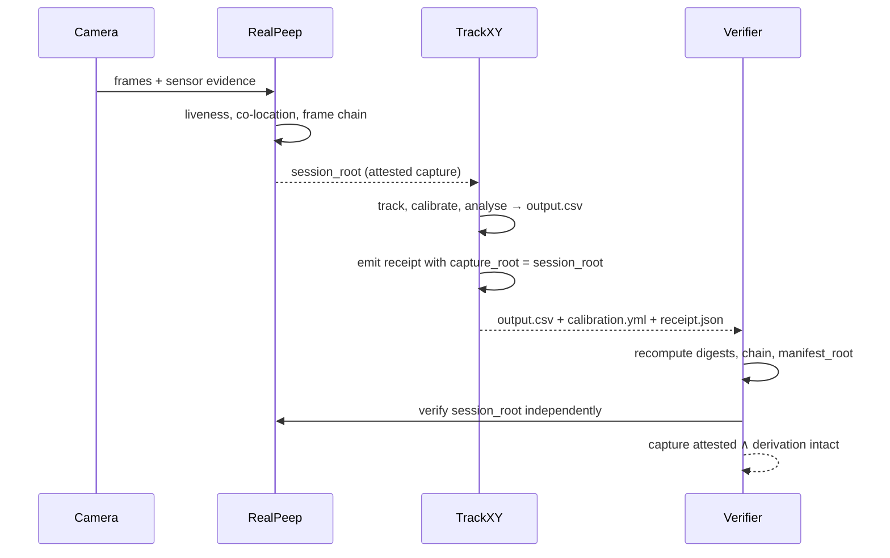

# Measurement provenance

*How a TrackXY result file becomes a claim that can be checked, and how it composes with
[RealPeep](https://github.com/LiamDGray/realpeep)'s capture attestation.*

## The gap this closes

TrackXY produces `output.csv`. A CSV is a text file. Anyone can edit a row, delete a segment where
the tracker lost the target, or re-run with a different scale and present the result as the original.
The instrument therefore produces a **claim**, and a claim without provenance is worth exactly the
reader's trust in the author.

RealPeep already answers a harder and more valuable question: *did this video come from real hardware,
at a real time, without identifying the device?* Its four layers establish liveness and hardware
identity (ZK identity scrubbing), physical co-location (acoustic CDMA mesh), frame-level integrity
(hash chain), and existence-in-time (OpenTimestamps anchor).

Neither system closes the loop alone. RealPeep attests the **source**; TrackXY derives the **number**.
Nothing currently binds them, which leaves the same gap at a higher level: a genuine video can sit
next to a fabricated analysis of it.

## What a receipt proves

`tools/measurement_receipt.py` binds a CSV to its inputs and emits a JSON receipt. Two distinct
properties, often conflated:

| Property | Mechanism | What it rules out |
|---|---|---|
| **Integrity** | SHA-256 of CSV, calibration and video; hash chain over CSV rows; `manifest_root` over the whole payload | Editing a row, appending samples, changing the scale, editing the receipt |
| **Recomputability** | Deterministic tool + recorded parameters + recorded inputs | "These are the numbers, trust me" — a third party can regenerate them |

Integrity alone is weak: a hash proves a file is unchanged since hashing, not that it was produced by
anything in particular. Recomputability is the substantive claim — *run the tool on these inputs with
these parameters and you get these numbers* — and it is why the parameters that change the numbers
(window size, pyramid levels, termination criteria, analysis window) are recorded even though they do
not affect the CSV bytes.

## Threat model

| Adversary action | Detected by | Not detected by |
|---|---|---|
| Edit a CSV row | Row chain root; sha256 | — |
| Append or delete samples | Row count, then chain root | — |
| Change the calibration scale | Calibration sha256 | — |
| Edit the receipt (e.g. lower `rows`) | `manifest_root` recomputation | — |
| Substitute a different video | Video sha256 | — |
| Re-run with different parameters | Recorded `parameters` block (reveals the change) | Replay of a *matching* receipt is legitimate |
| Fabricate the whole run | Nothing in the receipt | Capture attestation (RealPeep) |
| Mis-calibrate the apparatus | Nothing | Physics is not attested by software |
| Point the camera at a photograph | Nothing in the receipt | Liveness/co-location layers of RealPeep |
| Backdate a genuine measurement | Nothing | Timestamp anchoring |

The bottom four rows are the honest boundary. A receipt proves the chain from capture to arithmetic;
it does not prove the apparatus was set up correctly, that the calibration target was the right
length, or that the scene was real. Those are exactly the questions RealPeep's layers 1 and 2
address, which is why the composition matters.

## Composition with RealPeep



| Receipt field | Source | Anchor |
|---|---|---|
| `inputs.video.sha256` | TrackXY | Binds the analysed bytes |
| `capture.session_root` | RealPeep | Binds those bytes to an attested capture session |
| `rows.chain_root` | TrackXY | Binds the numbers to the file |
| `parameters` | TrackXY | Binds the numbers to the algorithm configuration |
| `manifest_root` | TrackXY | Covers all of the above; the thing to timestamp |

Anchoring `manifest_root` via RealPeep's `BlockchainAnchor` (OpenTimestamps) upgrades "this receipt
exists" to "this receipt existed by this time". The two systems already share the primitive: RealPeep
anchors a Merkle root, and `manifest_root` is a Merkle-style root over the receipt payload.

## Implemented today

`tools/measurement_receipt.py`, with nine tests in `tests/test_measurement_receipt.py`:

```bash
# after a run
tools/measurement_receipt.py emit \
  --csv output.csv --calibration calibration.yml --video pendulum.mp4 \
  --capture-root "$REALPEEP_SESSION_ROOT" \
  --out measurement.receipt.json

# on another machine, later
tools/measurement_receipt.py verify --receipt measurement.receipt.json
# → OK: receipt matches its inputs
```

Implementation notes:

- The chain is `h_i = SHA256(h_{i-1} ‖ line_i)` seeded with the schema string, so a chain root is
  domain-separated and not reusable as a bare file hash.
- `created_at` is excluded from `manifest_root`, so re-emitting an identical run is byte-identical
  except for the timestamp.
- Parameters live in `DEFAULT_PARAMETERS` and mirror `TrackerConfig`; overriding them is possible
  (`--parameters`) and visible in the receipt.

## Not built yet

In rough order of value:

1. **Row → frame binding.** The receipt covers the CSV as a whole. Binding each row to the frame index
   it came from (and therefore to a range of the capture hash chain) would let a verifier check *which
   frames* produced *which numbers*, and would make a spliced analysis detectable even if the CSV were
   regenerated to match.
2. **Signing.** A receipt is currently self-authenticating but not attributable. An Ed25519 device or
   operator key over `manifest_root` would let a lab publish receipts that anyone can attribute
   without a PKI.
3. **Anchoring.** Wire `manifest_root` into RealPeep's `BlockchainAnchor.create_timestamp` and store the
   `.ots` proof beside the receipt.
4. **A standalone verifier.** A ~200-line script with no dependency on TrackXY, so a third party can
   check a receipt without trusting the tool that produced it. (Today `verify` lives in the same file
   as `emit`, which is convenient and slightly incestuous.)
5. **Schema for a measurement *set*.** A lab produces many runs; a Merkle root over receipts gives a
   single anchor per experiment.

## Evaluation plan

If this is written up, the claim to test is: *the chain survives a realistic adversary.* Concretely:

- **Attack suite.** Each row of the threat model becomes a test: mutate the artefact, assert the
  verifier rejects it with a specific, non-generic message.
- **False positive rate.** Re-emit the same run on a second machine with a different OpenCV build; the
  receipt must verify if the CSV is bit-identical, and must *fail loudly* if OpenCV's output drifts
  between versions — which is itself a finding worth reporting.
- **Cost.** Emit and verify are O(bytes); measure throughput on full-length clips.

The interesting negative result, if it appears, is numerical non-determinism across OpenCV builds.
That would bound the recomputability claim to "same toolchain" and is exactly the kind of limitation
a provenance paper should report rather than hide.

## Why this is worth doing

Reproducibility debates usually stop at "share the data". For instrument-derived measurements, sharing
the CSV is not enough — the data is a function of a capture, a calibration and a parameter set, and
without all three the numbers are not reproducible, merely available. A receipt makes that function
explicit and checkable, and the composition with capture attestation makes the whole chain auditable
from photon to plotted point. That is a defensible research contribution, a useful piece of software,
and a teaching example that fits in a single lab session.
