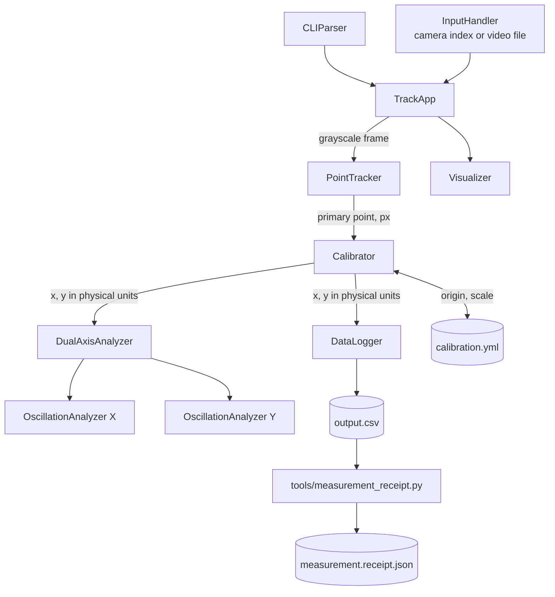

# TrackXY — technical report

**Optical measurement of planar oscillation from a webcam, with receivable numbers**

Version 0.1.0 · 2026 · AGPL-3.0 · [source](https://github.com/LiamDGray/TrackXY)

---

## Abstract

TrackXY measures the two-dimensional position of a visual target over time and derives oscillation
properties — frequency, amplitude and inter-axis phase — from that trajectory. It began in 2012 as a
Windows tool built to instrument a torsion pendulum, and was rebuilt in 2026 on C++17 and OpenCV 4.x
with the properties that make a measurement instrument trustworthy rather than merely functional:
explicit units, a defined failure mode, a schema-stable output, and a test suite that runs without a
camera.

This report documents the method and its assumptions, states what has and has not been verified,
and specifies a **measurement receipt** that binds a result file to the capture it came from — the
first step toward instrumentation whose output can be independently checked rather than merely
trusted.

## 1. Motivation

A webcam is a poor instrument and an excellent sensor. It is cheap, ubiquitous, and already pointed
at the experiment; what it lacks is everything that makes a measurement defensible — a scale, a
frame of reference, a documented failure mode, and an audit trail.

Most laboratory vision code is a script: it reads frames, tracks a feature, prints numbers. That is
sufficient for a demonstration and insufficient for a result. The gap is not accuracy. It is
*legibility*: given a column of numbers and a photograph of the apparatus, a reader cannot tell
which pixels produced which value, whether the tracker ever lost the target, or what the numbers
would be if the analysis window were different.

TrackXY is an attempt to close that gap for one narrow, common case: a single well-textured target
moving slowly in a plane, viewed roughly square-on. The constraint is deliberate. Everything here is
tractable at that scope, and the tractable version is the one that gets used.

## 2. System overview



`TrackApp` owns the frame loop. Every other component can be constructed and exercised without a
camera, a window, or a display — which is what makes the test suite meaningful rather than
decorative. Details and contracts are in [architecture.md](architecture.md).

## 3. Method

### 3.1 Tracking

Feature initialisation uses Shi–Tomasi corner detection (`goodFeaturesToTrack`, quality 0.01, minimum
distance 10 px, block size 3, Harris detector disabled, `k = 0.04`) followed by sub-pixel refinement
on a 10×10 window with a 20-iteration / 0.03 px termination criterion. Detection is confined to a
user-drawn region of interest by a binary mask, which is what keeps the tracker on the target instead
of on the room.

Displacement between frames is estimated with pyramidal Lucas–Kanade optical flow
(`calcOpticalFlowPyrLK`) using a 31×31 window, three pyramid levels, a minimum eigenvalue threshold of
0.001, and the same termination criterion. The method assumes brightness constancy and small
inter-frame displacement, both of which hold for a pendulum filmed at 30 fps and violated by a fast
transient or a lighting change. When the assumption fails, the algorithm reports it — see §3.3.

Three points are tracked: a **primary** point and two **chaperones** that help the detector recover
when part of the target degrades. The contract that matters is that index 0 is always the same
physical feature. If the primary point is lost, tracking stops rather than promoting a chaperone into
its place. A tracker that silently switches targets produces data that looks continuous while
measuring something else, which is worse than missing data.

### 3.2 Calibration

Two parameters map pixels to physical units:

- **origin** — the pixel coordinate assigned to `(0, 0)`.
- **pixelsPerUnit** — the scale, derived from the operator's answer to "how far is 100 pixels?".

The transform is a translation and a uniform scale: `p_phys = (p_px − origin) / pixelsPerUnit`. There
is no rotation, no perspective correction, and no lens-distortion model. For a camera square-on to a
planar target this is exact; for an oblique view it is wrong, and no part of the system pretends
otherwise. Calibration persists as YAML (`cv::FileStorage`), so a rig is calibrated once.

The scale prompt is the highest-risk interaction in the program, because `setScale(100, units)`
stores `100 / units` and an operator reading the code as "units per pixel" inverts the result by a
factor of 100. The README and the interactive prompt both state the direction explicitly for that
reason; it is the kind of error that survives every downstream calculation.

### 3.3 Failure behaviour

Tracking failure is an output, not an exception. When the status vector reports the primary point
lost, the tracker clears its state and the logger stops writing rows. A gap in the CSV therefore
means "no valid measurement", never "the process was slow". This is a deliberate design choice in
favour of data that is admittedly incomplete over data that is quietly wrong.

### 3.4 Analysis

Both axes share an `OscillationAnalyzer`: a 500-sample moving window (≈17 s at 30 fps) over which it
computes the mean, the amplitude as half peak-to-peak, and mean crossings by sign change with linear
interpolation of the crossing time. With at least four crossings, the average gap between consecutive
crossings is a half-period, and

```
f = 1000 / (2 · avgHalfPeriod)          [Hz, timestamps in ms]
```

`DualAxisAnalyzer` holds one analyser per axis. For each X crossing it finds the nearest Y crossing in
the same direction, converts the time offset into degrees of the X period (`dt / periodX × 360`), wraps
into `[−180°, +180°]`, and averages. Fewer than four crossings on either axis reports 0° and the
overlay labels the phase as unavailable rather than showing a measurement of zero.

Phase is the most fragile quantity in the system. The nearest-crossing estimator is biased toward 0°
under noise, because the nearest same-direction crossing is usually correct and occasionally the
adjacent one. It is adequate for a clearly oscillating pendulum and meaningless near the noise floor.
A Hilbert-transform or sinusoidal-fit estimator would remove the bias; the current method is
documented here rather than silently trusted.

## 4. Verification status

Honesty about evidence is part of the instrument's design, so this section states exactly what is
known.

| Claim | Status |
|---|---|
| Unit-level behaviour of tracker, calibration, logger, CLI, analysers | Asserted by eleven Catch2 cases (`tests/`), runnable with `ctest` |
| Receipt emit/verify, including tamper detection | Asserted by nine Python tests (`tests/test_measurement_receipt.py`) |
| End-to-end accuracy against known ground truth | **Not measured.** No synthetic-trajectory benchmark exists yet |
| Robustness to lighting change, motion blur, occlusion | **Not characterised** |
| Cross-platform build | CMake + C++17, but CI is **not configured** |

The absent row is the important one. Everything above is verification of *implementation*; none of it
is verification of *accuracy*. §7.1 proposes the benchmark that would close it, and no claim in this
report depends on accuracy that has not been measured.

## 5. Measurement provenance

A CSV is trivially editable, so an instrument that produces one has produced a claim, not evidence.
`tools/measurement_receipt.py` binds the claim to its inputs:

```bash
tools/measurement_receipt.py emit \
  --csv output.csv --calibration calibration.yml --video clip.mp4 \
  --capture-root "$REALPEEP_SESSION_ROOT" --out measurement.receipt.json

tools/measurement_receipt.py verify --receipt measurement.receipt.json
```

The receipt records SHA-256 digests of the CSV, the calibration file and (optionally) the source
video; the analysis parameters that change the numbers but not the file bytes; a hash chain over the
CSV rows; and a `manifest_root` over all of it. Verification recomputes every field and reports the
first divergence — a modified row, an appended sample, a nudged scale, or a receipt that has itself
been edited.

Two properties follow, and they are different:

- **Integrity.** The numbers are the ones described by the receipt. A hash chain gives this.
- **Recomputability.** Given the same frames, calibration and parameters, the tool reproduces the
  same CSV, so a third party can regenerate the measurement rather than merely check a digest.
  Deterministic replay gives this, and it is the stronger claim.

`--capture-root` is the seam to [RealPeep](https://github.com/LiamDGray/realpeep), which attests that a
video came from real hardware at a real time without identifying the device. Passing its session root
into the receipt turns *"these numbers came from this file"* into *"these numbers came from that
attested capture"*; anchoring the manifest root (OpenTimestamps, as RealPeep already does) extends it
to *"…and existed by this time"*. The full threat model, receipt schema and remaining work are in
[measurement-provenance.md](measurement-provenance.md).

What this does **not** do: a receipt cannot prove the apparatus was set up correctly, that the
calibration target was the right length, or that the camera was not pointed at a photograph. It
proves the chain from attested capture to arithmetic is intact. That is a narrower claim than "the
science is right", and it is the only one worth making.

## 6. Limitations

1. **Uniform scale only** — no rotation, perspective, or lens distortion (§3.2).
2. **Phase bias** toward 0° under noise (§3.4).
3. **Interactive by design.** Batch processing of many clips means scripting GUI key events, which is
   not supported. This is the largest obstacle to using TrackXY as a research tool.
4. **No accuracy benchmark** (§4).
5. **`sample.csv` in the repository predates the current schema** and is preserved as a historical
   artefact, not a format reference.

## 7. Where this could go

Three directions, in ascending order of effort. They are complementary; the first is a prerequisite
for credibility in the other two.

### 7.1 As software: become a trustworthy component

- **Headless batch mode** (`--input clip.mp4 --roi x,y,w,h --no-gui`) so a directory of clips can be
  processed without an operator. This unlocks everything else.
- **Synthetic benchmark.** Render a marker moving along a known trajectory (circle, damped sinusoid,
  linear ramp) with controlled noise and blur; measure recovered frequency, amplitude and phase
  against ground truth. This is the missing row in §4 and the single most valuable addition.
- **Schema versioning** in the CSV header, plus a `--format` flag, so downstream tooling is not broken
  by column changes.
- **Packaging and CI**: OpenCV 4 in a container, `ctest` on Linux and macOS per commit, and a vcpkg or
  conan recipe. A tool that a stranger cannot build in one command is a tool that will not be used.
- **Library surface**: expose `PointTracker` and the analysers as a small static library with a C API,
  so the measurement engine can be embedded in a lab's own acquisition code.

### 7.2 For education: an instrument students can audit

The apparatus is a webcam, a printed marker, and a pendulum; the experiment is "measure *g* from the
period of a pendulum", and the analysis is already done. A lab module built on TrackXY teaches two
things at once, which is rare:

1. **Physics** — period versus length, the small-angle approximation, uncertainty propagation from
   pixel scale to *g*.
2. **Data integrity** — the receipt makes tampering visible, so a student can be shown the difference
   between "my measurement agrees" and "my measurement is the one I actually made". That is normally
   taught as a lecture about academic honesty; here it is a command they run.

The phase output adds a third, cheaper experiment: a target moving in a circle versus in a line, where
the phase difference is 90° versus 0°/180°, and the estimator's noise floor becomes a lesson in
measurement limits rather than a footnote.

### 7.3 For research: measurement provenance as a contribution

The generalisable claim is not about pendulums. It is that **derived measurements should carry a
replayable proof of their inputs**, and that capture attestation (RealPeep) and derivation attestation
(this receipt) compose into an end-to-end chain from sensor to number.

That framing has a literature to join — computational reproducibility in measurement science, content
provenance standards such as C2PA, and timestamp anchoring — and a natural evaluation: does the chain
survive a realistic adversary (edited CSV, substituted video, re-calibrated scale, replayed receipt)?
The remaining work is concrete: bind each CSV row to the *frame range* it was derived from (not just
the file), sign receipts with a device key, and anchor the manifest root. Those three steps convert a
prototype into something publishable.

## 8. References

1. B. D. Lucas, T. Kanade. *An iterative image registration technique with an application to stereo
   vision.* IJCAI, 1981.
2. J.-Y. Bouguet. *Pyramidal implementation of the Lucas–Kanade feature tracker.* Intel Research,
   2000.
3. S. Baker, I. Matthews. *Lucas–Kanade 20 years on: a unifying framework.* IJCV 56(3), 2004.
4. J. Shi, C. Tomasi. *Good features to track.* CVPR, 1994.
5. OpenTimestamps. <https://opentimestamps.org>
6. C2PA Content Credentials. <https://c2pa.org>
7. RealPeep — anonymous proof of capture. <https://github.com/LiamDGray/realpeep>
8. J. N. Hansen, J. A. Lieberman. *Use of a torsion pendulum balance to detect and characterize what
   may be a human bioenergy field.* Journal of Scientific Exploration 27(2), 2013. The protocol this
   instrument was built to reproduce; see [instrumenting a torsion
   balance](how-to/instrument-a-torsion-balance.md).

## Appendix A — Output schema

`output.csv`, written by `DataLogger`:

| Column | Meaning |
|---|---|
| `samplenumber` | Monotonic counter, from 1 |
| `milliseconds` | Elapsed time since start (`std::chrono::steady_clock`) |
| `x_px`, `y_px` | Raw pixel coordinates of the primary point |
| `x_cal`, `y_cal` | Calibrated coordinates in user units |
| `status` | `tracking`, or a `Start:` annotation on the first row |

A header row is written at construction and followed by a `Start:` row stamped with wall-clock time.
Downstream tooling should ignore rows whose `status` is not `tracking`.

## Appendix B — CLI

```
trackxy [-i|--input SOURCE] [-o|--output FILE] [-c|--calibration FILE] [-n|--night] [-h|--help]

  -i  camera index (e.g. 0) or path to a video file. Default: 0
  -o  output CSV. Default: output.csv
  -c  calibration file. Default: calibration.yml
  -n  night mode (black background, higher contrast)
```

Keys: `Esc` quit · `r` draw ROI and re-initialise · `c` clear tracking · `n` night mode · `s` save
calibration · `o` set origin at the current point · `k` set scale (100 px = *n* units).

## Appendix C — A receipt

```json
{
  "schema": "trackxy-measurement-receipt/v1",
  "tool": { "name": "trackxy", "version": "0.1.0" },
  "inputs": {
    "csv": { "path": "output.csv", "sha256": "…", "rows": 4211 },
    "calibration": { "path": "calibration.yml", "sha256": "…" },
    "video": { "path": "pendulum.mp4", "sha256": "…" }
  },
  "parameters": { "max_points": 3, "win_size": [31, 31], "analysis_window": 500, "…": "…" },
  "rows": { "chain_root": "…" },
  "capture": { "provider": "realpeep", "session_root": "…" },
  "created_at": "2026-11-12T22:00:00+00:00",
  "manifest_root": "…"
}
```
